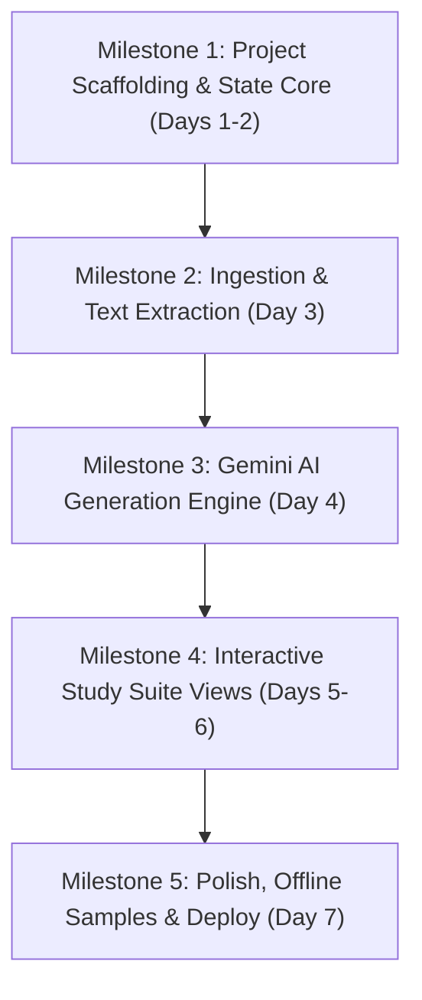

# StudySpark — Engineering Architecture & Implementation Plan

## 1. Technology Stack (Beginner-Friendly & Hackathon-Ready)

To maximize development velocity and eliminate DevOps overhead for a single-person hackathon, StudySpark is architected as a modern, high-performance Client-Side Single Page Application (SPA) with zero backend server dependencies for core functionality.

| Layer | Selected Technology | Justification |
| :--- | :--- | :--- |
| **Framework & Build** | **React 18 + TypeScript + Vite** | Instant hot-reloading (HMR), minimal boilerplate, fast builds, beginner-friendly component model. |
| **Styling & Icons** | **Tailwind CSS + Lucide React** | Rapid utility-first styling, responsive out-of-the-box, no CSS file sprawl, consistent icon set. |
| **Document Processing**| **`pdfjs-dist` (Client-side)** | Extracts text directly in the student's browser without requiring server-side upload endpoints. |
| **AI Synthesis Engine** | **Google Gemini 1.5/2.0 Flash API** | Ultra-low latency, large context window (for long lecture slides), structured JSON output enforcement. |
| **Local Persistence** | **Browser `localStorage` + JSON API** | Zero database configuration, works offline, persists across browser reloads, zero hosting costs. |
| **Delight & Animations**| **`canvas-confetti` + CSS 3D Transforms** | Lightweight celebration animations for quiz wins and smooth 3D flashcard flips. |
| **Hosting & Deployment**| **Vercel / Netlify / GitHub Pages** | 1-click continuous deployment, zero cost, global CDN distribution. |

---

## 2. Proposed Project Structure

```
studyspark-ai/
├── public/
│   ├── favicon.svg
│   └── samples/                  # Pre-loaded offline sample study sets (CS, Bio)
│       └── cs101-sample.json
├── src/
│   ├── assets/                   # Static graphics, icons, illustration SVGs
│   ├── components/               # Modular UI building blocks
│   │   ├── common/
│   │   │   ├── Button.tsx
│   │   │   ├── Card.tsx
│   │   │   ├── Badge.tsx
│   │   │   ├── Modal.tsx
│   │   │   └── ProgressBar.tsx
│   │   ├── dashboard/
│   │   │   ├── StatsOverview.tsx
│   │   │   ├── StudySetCard.tsx
│   │   │   └── EmptyState.tsx
│   │   ├── ingestion/
│   │   │   ├── IngestionModal.tsx
│   │   │   ├── PdfDropzone.tsx
│   │   │   └── TextPasteInput.tsx
│   │   └── workspace/
│   │       ├── CheatSheetView.tsx
│   │       ├── QuizRunner.tsx
│   │       ├── FlashcardDeck.tsx
│   │       └── StudyScheduleView.tsx
│   ├── hooks/                    # Reusable React hooks
│   │   ├── useLocalStorage.ts    # Type-safe persistent state hook
│   │   └── useKeyboardShortcut.ts# For flashcard flip & quiz selection
│   ├── services/                 # Core business & API logic
│   │   ├── gemini.ts             # AI prompt orchestration & JSON schema parsing
│   │   ├── pdfParser.ts          # Client-side PDF text extraction
│   │   ├── storage.ts            # CRUD operations for study sets in localStorage
│   │   └── sampleData.ts         # Fallback data for offline/demo operation
│   ├── types/                    # Domain TypeScript interfaces
│   │   └── study.ts
│   ├── utils/                    # Helper functions
│   │   ├── exportMarkdown.ts     # Converts study set to readable Markdown file
│   │   └── timeUtils.ts          # Countdown calculations
│   ├── App.tsx                   # Main state machine & navigation controller
│   ├── main.tsx                  # React entry point
│   └── index.css                 # Tailwind directives & custom animations
├── package.json
├── tsconfig.json
├── vite.config.ts
├── tailwind.config.js
└── README.md
```

---

## 3. Data Models & Local Persistence

All user study data is organized into self-contained `StudySet` records saved in browser `localStorage` under the key `studyspark_data_v1`.

### TypeScript Domain Interfaces (`src/types/study.ts`)

```typescript
export interface StudySet {
  id: string;                      // UUID or timestamp-based ID
  title: string;                   // e.g., "CS 101: Binary Search Trees"
  subject: string;                 // e.g., "Computer Science"
  examDate?: string;               // ISO date string: "2026-11-15"
  createdAt: string;               // ISO date string
  rawSourceSnippet: string;        // First 300 chars of source text
  
  // High-Yield Output Modules
  cheatSheet: CheatSheetData;
  quiz: QuizQuestion[];
  flashcards: FlashcardItem[];
  schedule: ScheduleTask[];
  
  // User Tracking
  quizHistory: QuizAttempt[];
  flashcardMastery: Record<string, boolean>; // flashcardId -> mastered
}

export interface CheatSheetData {
  summary: string;
  keyTerms: { term: string; definition: string }[];
  formulasAndRules: { label: string; formula: string; explanation: string }[];
  examTraps: string[];             // Common student errors to avoid
}

export interface QuizQuestion {
  id: string;
  question: string;
  options: string[];               // 4 options [A, B, C, D]
  correctIndex: number;            // 0 to 3
  explanation: string;             // Detailed breakdown of correct rationale
  category?: string;               // e.g., "Definitions", "Edge Cases"
}

export interface QuizAttempt {
  id: string;
  timestamp: string;
  score: number;
  totalQuestions: number;
  userAnswers: Record<string, number>; // questionId -> selectedIndex
}

export interface FlashcardItem {
  id: string;
  front: string;                   // Question / Term
  back: string;                    // Answer / Core explanation
  hint?: string;
}

export interface ScheduleTask {
  id: string;
  dayOffset: number;               // e.g. Day 1, Day 2, Day 3
  title: string;
  description: string;
  completed: boolean;
}
```

### Persistence Logic
* **Storage Schema Key:** `studyspark_data_v1`
* **Version Migration:** The storage layer includes a version check. If the schema updates, existing records are automatically migrated.
* **Auto-Fallback:** If the user has never created a study set, the app automatically pre-populates the local database with an interactive "Computer Science: Algorithms" demo set so judges and users have immediate interactivity without entering an API key.

---

## 4. Feature Implementation Plan (5-Milestone Roadmap)



### Milestone 1: Project Scaffolding & State Core
* Initialize Vite + React + TypeScript + Tailwind CSS project.
* Build foundational UI components (`Button`, `Card`, `Badge`, `Modal`, `Navbar`).
* Implement `useLocalStorage` hook and `storage.ts` CRUD functions.
* Seed sample study set for immediate testing.

### Milestone 2: Document Ingestion & Parsing
* Implement `PdfDropzone.tsx` with drag-and-drop file upload.
* Integrate `pdfjs-dist` to extract plain text from uploaded PDF slides.
* Implement `TextPasteInput.tsx` for direct syllabus/note pasting with word count meter.
* Add form validation (prevent empty inputs or corrupt files).

### Milestone 3: Gemini AI Generation Engine
* Create `gemini.ts` service with structured JSON output prompts.
* Define strict prompt schemas instructing the model to return:
  1. High-Yield Cheat Sheet (Terms, Formulas, Pitfalls).
  2. 10 Multiple-Choice Questions with explanations.
  3. 12 Active Recall Flashcards.
  4. 3 to 5 Day Exam Schedule.
* Implement error handling, fallback mock generator (in case of API key absence/timeout), and loading step indicator.

### Milestone 4: Interactive Study Suite
* Build **CheatSheetView**: Syntax highlighting, copy-to-clipboard, and printable layout.
* Build **QuizRunner**: Option selection, immediate emerald/rose answer reveals, dynamic explanation cards, and confetti completion screen.
* Build **FlashcardDeck**: 3D flip card animation, keyboard controls (`Space` to flip, `Arrow` keys for Got It / Review), and mastery counter.
* Build **StudyScheduleView**: Interactive checkboxes with state persistence.

### Milestone 5: Polish, Mobile Testing & Deployment
* Add responsive adjustments for mobile screens (touch targets $\ge 48\text{px}$).
* Export features: Download Cheat Sheet as `.md` or formatted `.txt`.
* Audit accessibility and keyboard focus indicators.
* Deploy to Vercel/Netlify and verify live production build.

---

## 5. Testing Strategy & Clear Pass/Fail Criteria

### Automated & Manual Verification Matrix

| Area | Test Description | Pass Criteria | Fail Criteria |
| :--- | :--- | :--- | :--- |
| **PDF Extraction** | Upload a multi-page lecture slide deck (15–30 pages) | Text extracted cleanly within 3 seconds; text length $\ge 500$ characters | Browser crashes, extraction freezes, or returns empty string |
| **AI Schema Compliance** | Request Study Set generation from text | Response validates 100% against `StudySet` TypeScript schema with all fields populated | Malformed JSON, missing questions, or undefined explanations |
| **Quiz Execution** | Complete a 5-question quiz with mixed correct/incorrect choices | Correct choices display green; wrong choices display red; explanation shows instantly; final score calculates accurately | Score miscalculation or failure to reveal explanation |
| **Flashcard Interactivity** | Flip card using Spacebar and click "Got It" | Card smoothly flips 180 degrees; card marked as mastered; counter increments by 1 | Flip animation stutters or mastery state fails to update |
| **State Persistence** | Refresh the browser tab after completing a quiz and creating a set | All study sets, completed tasks, and quiz scores remain intact | Data is cleared or returns to default state |
| **Mobile Responsiveness** | Test interface on 375px mobile viewport | Zero horizontal scrolling; all buttons easily clickable; navigation tabs accessible | Elements clip off-screen or text overlaps |
| **Offline / API Fallback** | Disconnect internet or provide no API key | Displays friendly notification and automatically loads high-quality pre-rendered sample study set | Infinite loading spinner or unhandled JavaScript crash |

---

## 6. Known Limitations & Deployment Plan

### Known Limitations
1. **Scanned PDF Images:** `pdfjs-dist` extracts embedded text; image-only scanned lecture notes require OCR (marked as Phase 3 post-hackathon enhancement).
2. **Context Window on Giant Textbooks:** For files $>50$ pages, text will be sliced to the first 40,000 characters to prevent token overflow and ensure sub-15 second response times.
3. **Browser Storage Caps:** Standard `localStorage` is capped at ~5MB–10MB per origin. For an MVP storing text-only study sets, this safely supports over 100 study sets.

### Deployment Plan
1. **Repository Setup:** Verify code is committed to Git with clean commit history.
2. **Environment Variables:**
   * Support an optional `VITE_GEMINI_API_KEY` for hosted live demos.
   * Provide a clean client-side "Settings" modal so any evaluator or user can enter their own free Google Gemini API key if desired.
3. **Production Build Verification:**
   * Run `npm run build` to ensure zero TypeScript errors and optimal bundle splitting.
4. **Vercel / Netlify Deployment:**
   * Connect GitHub repository to Vercel/Netlify for automated continuous deployment on `main` branch.
   * Enable SPA routing redirects (`_redirects` or `vercel.json` rewrite rule).

