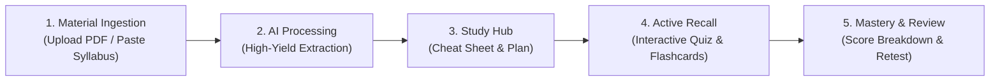

# StudySpark — Product Requirements Document (PRD)

## 1. Problem Statement & Target Users

### Problem Statement
College students are constantly bombarded with unstructured, scattered learning materials: dense 80-slide lecture decks, expansive syllabus outlines, video lectures, and fragmented class notes. 

When exams approach, students experience severe cognitive overload. Instead of spending their limited time actively learning and testing their comprehension, they spend hours manually parsing, condensing, and summarizing content into study guides. Traditional study tools are either too generic (standard flashcard apps requiring hours of manual card creation) or too bloated with multi-user enterprise features.

### Target Users & Personas

* **Primary Audience:** Undergraduate and graduate college students taking STEM, business, humanities, or medical/nursing courses with high concept density and fast-paced exam cycles.
* **Persona 1: "The Night-Before Crammer" (Alex, 20)**
  * *Pain Point:* Has 48 hours before a biology midterm and 3 lecture slide decks totaling 180 slides.
  * *Goal:* Wants immediate high-yield facts, core definitions, and formulas distilled without fluff so they can pass.
* **Persona 2: "The Methodical Reviewer" (Priya, 22)**
  * *Pain Point:* Reads through notes repeatedly (passive review) but lacks realistic practice questions to identify actual weak spots.
  * *Goal:* Needs an active recall environment—instant quizzes with clear rationales and spaced flashcards to solidify long-term retention.

---

## 2. User Needs & Main User Journey

### Core User Needs
1. **Frictionless Ingestion:** Zero-effort input processing—drop lecture slides or paste text and get started immediately.
2. **Instant High-Yield Synthesis:** Automatic extraction of the most exam-relevant concepts, definitions, and equations.
3. **Active Knowledge Verification:** Immediate diagnostic feedback through quizzes that explain *why* an option is correct or incorrect.
4. **Structured Retention:** Ready-to-use flashcards and an actionable exam countdown roadmap.
5. **Portability & Ownership:** The ability to review offline, track progress locally, and export notes without account hurdles.

### Main User Journey

1. **Upload & Setup:** Alex drops a lecture PDF or pastes syllabus topics into StudySpark, sets the course title, and optionally enters the exam date.
2. **Generation:** In under 15 seconds, StudySpark digests the material and generates a unified **Study Set** containing a Cheat Sheet, an Interactive Quiz, a Flashcard Deck, and an Exam Timeline.
3. **Cheat Sheet Review:** Alex reviews the distilled high-yield formulas, key terms, and common pitfalls.
4. **Active Testing:** Alex takes the interactive quiz. For every answer submitted, StudySpark displays immediate feedback with comprehensive explanations.
5. **Flashcard Drill:** Alex drills difficult concepts using keyboard-navigable flashcards, marking cards as "Mastered" or "Needs Review".
6. **Progress Retention:** Alex's progress, quiz scores, and study sets persist in local browser storage for quick review before the exam.

---

## 3. Main Features & Measurable Success Criteria

### Feature 1: Multi-Format Study Ingestion Engine
* Drag-and-drop support for PDF lecture slides and textbooks.
* Raw text paste tab for syllabus outlines, lecture transcripts, and notes.
* Extensibility for media URLs (YouTube video links) in subsequent releases.

### Feature 2: High-Yield Exam Cheat Sheet
* Bulletproof synthesis organized into:
  * **Core Definitions & Principles**
  * **Key Formulas / Laws / Axioms**
  * **Exam Traps & Common Misconceptions**
* One-click copy and Markdown export for offline printing or Obsidian/Notion import.

### Feature 3: Interactive Adaptive Quiz
* 5 to 15 targeted multiple-choice and conceptual questions per study set.
* **Instant Explanations:** Real-time rationale breakdown explaining why the selected option was correct/incorrect and why distractor options are wrong.
* Detailed score recap with targeted review recommendations based on missed questions.

### Feature 4: Active Recall Flashcard Deck
* Double-sided interactive flip cards with keyboard shortcuts (Space to flip, Arrow keys to navigate).
* Confidence tagging: "Got it" vs. "Study again" to dynamically isolate weak spots.
* Shuffle and reset capabilities.

### Feature 5: Exam Countdown & Study Schedule
* Generates a step-by-step checklist distributed across remaining days until the exam.
* Interactive checkboxes saved across sessions to maintain study momentum.

### Measurable Success Criteria (Hackathon / MVP Benchmark)

| Metric | Target Goal | Verification Method |
| :--- | :--- | :--- |
| **Generation Latency** | $\le 15$ seconds for standard 20-page slide deck | Automated client timing logs |
| **Quiz Engagement** | $\ge 85\%$ completion rate for initiated quizzes | Local session analytics |
| **Parsing Reliability** | $\ge 95\%$ text extraction success rate on standard college lecture PDFs | Test suite with varied PDF formats |
| **Zero Cloud Failure** | 100% functionality without remote database requirement | Browser offline & local persistence test |
| **Mobile Usability** | Zero layout breakage at 375px width | Lighthouse & mobile viewport audits |

---

## 4. MVP Scope vs. Excluded Features

### In Scope for MVP (Phase 1)
* [x] Client-side PDF text extraction and raw text/syllabus paste ingestion.
* [x] Gemini AI integration for structured Study Set generation (JSON schema enforcement).
* [x] High-Yield Cheat Sheet viewer with copy and download options.
* [x] Fully interactive Quiz runner with instant feedback and score summary.
* [x] Flippable Flashcard deck with confidence filtering.
* [x] Exam Countdown study schedule checklist.
* [x] Local storage persistence (saving, loading, and deleting study sets without login).
* [x] Pre-loaded sample study sets (e.g., "Intro to Computer Science", "Biology 101") for instant zero-click evaluation.

### Deliberately Excluded from MVP (Deferred to Future Iterations)
* ❌ **Multi-user Collaboration:** No real-time study rooms, shared live links, or multi-seat workspaces.
* ❌ **Real-Time Audio Streaming:** No live microphone recording or live lecture speech-to-text.
* ❌ **Native Mobile Applications:** No iOS/Android native codebase; strictly responsive web app.
* ❌ **Complex Authentication & Billing:** No Stripe, payment tiers, subscription management, or mandatory account creation.
* ❌ **Direct LMS Integration:** No API connections to Canvas, Blackboard, or Moodle.

